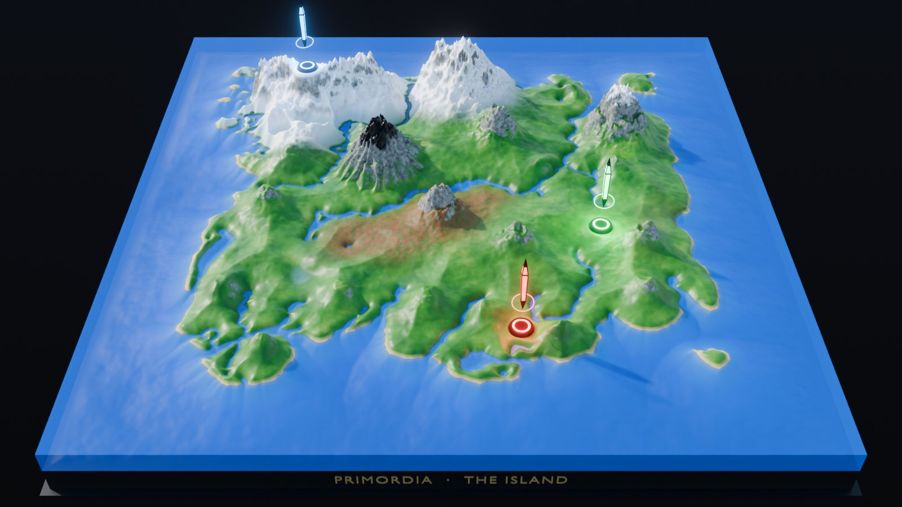

# PRIMORDIA

Maqueta digital 3D de **The Island** (ARK: Survival Evolved / Ascended) generada de forma
100 % procedural con Blender y exportada a `.glb` para web, móvil y motores de juego.



## Contenido

| Ruta | Qué es |
| --- | --- |
| `blender/primordia_island.py` | Script único de Blender: construye la escena completa y exporta el `.glb`. |
| `tools/extract_geography.py` | Regenera el bloque de datos geográficos a partir de un mapa cenital de referencia. |
| `viewer/` | Visor web (three.js) listo para Netlify, con la maqueta `PRIMORDIA_TheIsland.glb`. |
| `docs/` | Renders de referencia. |

## Uso rápido

**Desde Blender** (4.0 o superior · validado en 4.2 LTS, 4.5 LTS y 5.0):

1. Pestaña *Scripting* → *Abrir* → `blender/primordia_island.py` → **Run Script**.
2. En ~10 s tienes la escena; el horneado PBR y la exportación tardan ~30 s más
   (menos si Cycles tiene GPU configurada en *Preferencias → Sistema*).
3. El `.glb` se guarda junto al `.blend` (o en tu carpeta de usuario si no lo has guardado).

**Sin interfaz** (automatización / CI):

```bash
blender -b -P blender/primordia_island.py -- --glb viewer/PRIMORDIA_TheIsland.glb --render vista.png
```

| Opción | Efecto |
| --- | --- |
| `--glb RUTA` | Ruta del `.glb` exportado. |
| `--no-export` | Solo construye la escena (sin horneado ni `.glb`). |
| `--render PNG` / `--render-map PNG` | Render de la cámara aérea / cenital. |
| `--engine EEVEE\|CYCLES`, `--samples N` | Motor y muestras de render. |
| `--grid N` | Subdivisiones por lado (mínimo 200, por defecto 512). |
| `--style REALISTIC\|LOW_POLY` | *Shade Smooth* satélite o *Decimate* + *Shade Flat*. |

El resto de parámetros (altura, obeliscos, horneado, Draco…) está en la clase `CFG` al inicio del script.

## Cómo se construye

1. **Geografía real.** Costa, ríos, lagos y regiones de nieve, secuoyas y pantano son anillos
   vectoriales `lon,lat` extraídos del mapa in-game (bloque `GEO-DATA`). Se rasterizan con la regla
   par-impar y se calcula una distancia con signo exacta a la costa (Jump Flooding en numpy).
2. **Relieve.** Perfil costero continuo (playas anchas frente al mar, orillas abruptas en ríos,
   talud y relieve submarino), llanuras con ruido fBm, mesetas nevadas del norte, estratovolcán con
   cárcavas radiales y cráter, montañas con crestas multifractales y la cordillera Frozen Tooth.
3. **Detalle procedural.** Dos modificadores *Displace* no destructivos con texturas **Musgrave**
   (multifractal de crestas, solo en relieve alto) y **Clouds** (grano fino), calibrados para no
   desplazar el conjunto.
4. **Material PBR por nodos.** Capas por altura (Z), pendiente y bioma: selva (rugosidad baja),
   secuoyas, pantano, arena mate, roca, obsidiana metálica, nieve y fondo marino.
5. **Obeliscos.** Rojo, verde y azul en sus coordenadas in-game, con paneles emisivos, halo, terminal
   y luz de área de su color apuntando al suelo.
6. **Exportación.** El material se hornea a texturas (albedo sRGB + ORM) con Cycles y se exporta con
   normales suaves unificadas, *Decimate* de exportación (35 %) e imágenes JPEG. Resultado: ~6 MB.

### Coordenadas (1 unidad Blender = 1 grado ARK)

`x = lon − 50`, `y = 50 − lat` (norte = +Y). En el `.glb` (Y arriba): `(x, z, −y)`.

| Obelisco | Lat | Lon | Posición |
| --- | --- | --- | --- |
| Azul | 25.5 | 25.6 | Noroeste, sobre la nieve |
| Verde | 59.2 | 72.4 | Sureste |
| Rojo | 79.3 | 59.5 | Sur (ligeramente al este del centro) |

> El obelisco rojo del juego está al **sur**, no al suroeste. Se respetan las coordenadas reales;
> para moverlo basta con editar la tupla `OBELISKS`.

## Visor web

`viewer/` es una página estática (three.js 0.169 por CDN, CSP estricta, bloom selectivo para los
obeliscos, controles accesibles por teclado, adaptada a móvil). Se despliega tal cual en Netlify
(`netlify.toml` ya apunta a `viewer/`). En local necesita un servidor HTTP:

```bash
python -m http.server --directory viewer 8080   # → http://localhost:8080
```

Si activas `EXPORT_DRACO = True` el `.glb` pesa ~8× menos; el visor ya incluye `DRACOLoader`.

## Regenerar la geografía

```bash
pip install -r tools/requirements.txt
python tools/extract_geography.py mapa_referencia.png --write blender/primordia_island.py
```

La imagen debe ser cuadrada y cenital, cubriendo lat/lon 7.2 → 92.8 (el encuadre del mapa in-game).

## Notas

- El exportador glTF oficial avisa *"More than one shader node tex image used for a texture"* al
  empaquetar rugosidad y metal en la misma textura ORM. Es el empaquetado estándar de glTF y no
  afecta al resultado.
- Proyecto fan sin afiliación: *ARK: Survival Evolved/Ascended* y *The Island* son marcas de
  Studio Wildcard. El repositorio no incluye assets del juego, solo geometría y datos generados.
